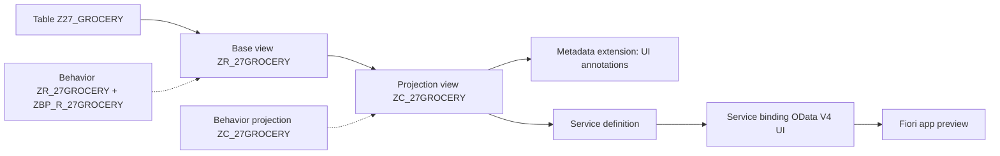
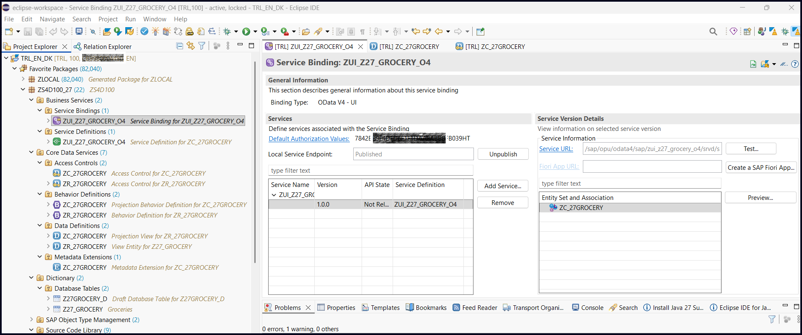
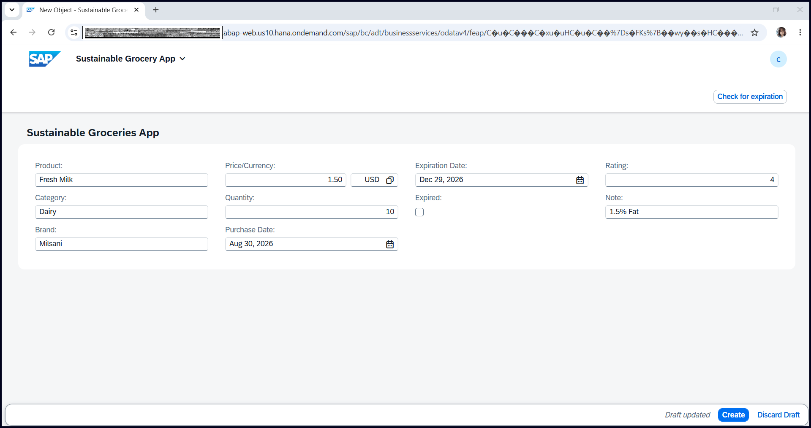
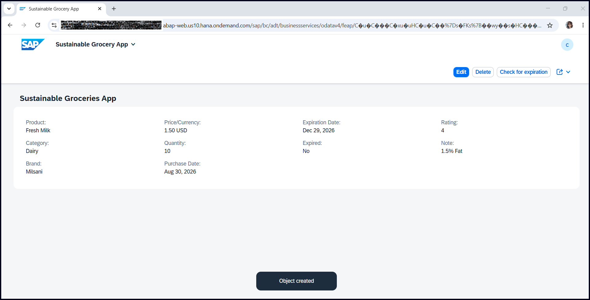
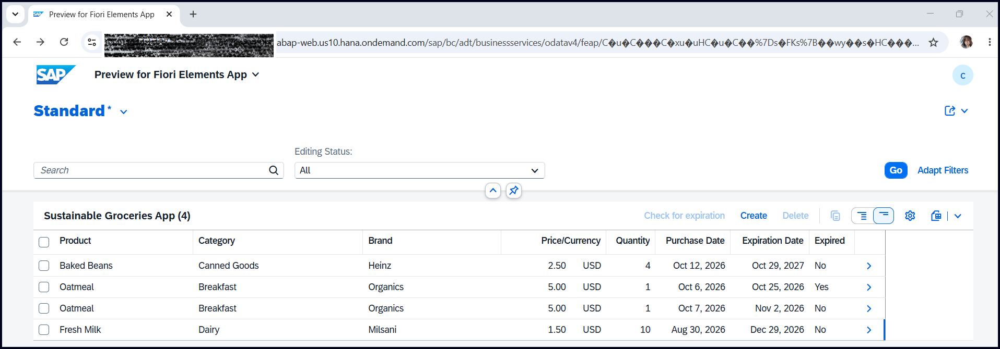

# Sustainable Grocery App

A small app for tracking groceries and their expiration dates, built with the **ABAP RESTful Application Programming Model (RAP)** on the SAP BTP ABAP environment (trial), using ABAP Development Tools in Eclipse. The data model and most of the technical objects were created with the ABAP repository object generator from one database table, then extended by hand with behavior, UI annotations and search.

## Features

- Create, edit and delete grocery items, with draft handling
- Search across product, category, brand, expiration date and rating
- A **Check for expiration** action that compares each item's expiration date with today's date and sets the `Expired` flag
- SAP Fiori elements UI, driven by CDS annotations and served as an OData V4 service

## Architecture

## Objects (package `ZS4D100_27`)

Naming follows the exercise pattern: `Z<Name>` for tables, `ZR_<Name>` for the model layer, `ZC_<Name>` for the projection layer, `ZBP_R_<Name>` for the behavior implementation and `ZUI_<Name>_O4` for the service.

### Data model

| Object | Type | Purpose |
|---|---|---|
| `Z27_GROCERY` | Database table | Stores the active grocery items |
| `Z27GROCERY_D` | Database table | Draft table for items that are still being edited |
| `ZR_27GROCERY` | CDS view entity (model) | Root view on the table |
| `ZC_27GROCERY` | CDS view entity (projection) | Projection with search annotations, exposed to the service |

### Behavior

| Object | Type | Purpose |
|---|---|---|
| `ZR_27GROCERY` | Behavior definition (model) | Managed implementation with draft, read-only fields, create/update/delete and the `checkExpirationDate` action |
| `ZBP_R_27GROCERY` | Class (behavior implementation) | Contains the logic of the `checkExpirationDate` action |
| `ZC_27GROCERY` | Behavior definition (projection) | Exposes the behavior and the action to the service |
| `ZBP_C_27GROCERY` | Class (projection behavior) | Generated class for the projection behavior |

### User interface

| Object | Type | Purpose |
|---|---|---|
| `ZC_27GROCERY` | Metadata extension | UI annotations: list columns, detail page, labels, hidden fields and the action button |

### Authorization

| Object | Type | Purpose |
|---|---|---|
| `ZR_27GROCERY` | Access control | Authorization rule for the model view |
| `ZC_27GROCERY` | Access control | Inherits the rule for the projection view |
| `7842BB9F...HT` | Authorization defaults | Default authorization values of the service |
| *(IAM app, name from the tree)* | IAM app | Identity and access management object for the service |

### Service

| Object | Type | Purpose |
|---|---|---|
| `ZUI_Z27_GROCERY_O4` | Service definition | Defines which entities are exposed |
| `ZUI_Z27_GROCERY_O4` | Service binding | Publishes the service as OData V4 UI |
| `ZUI_Z27_GROCERY_O4_0001_...` | Inbound service | Communication-management object generated for the service |

### Generated technical objects

| Object | Type | Purpose |
|---|---|---|
| `Z27_GROCERY` (two entries) | Object type management | Business object node types created by the generator |

## Technologies

ABAP Cloud, CDS, RAP (managed, draft), OData V4, SAP Fiori elements, abapGit

## Screenshots

### Service binding (published OData V4 service)

### Creating a new item (draft)

### Item created

### List report with search and the "Check for expiration" action

## About this repository

- The `src` folder is in abapGit format. Import it with abapGit instead of editing the files by hand.
- This is a learning project, built while following SAP's ABAP learning content.
